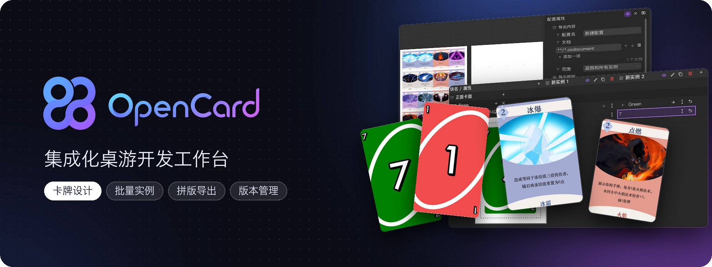
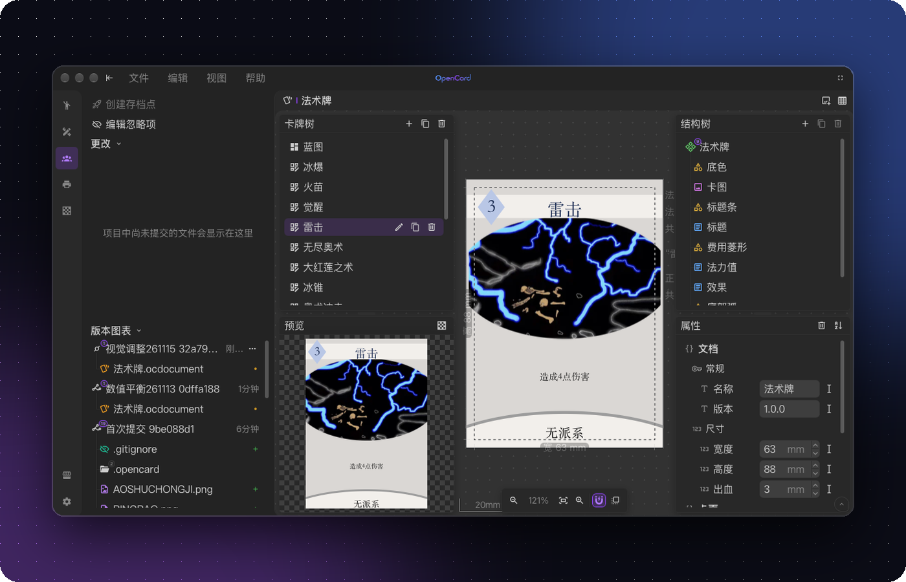
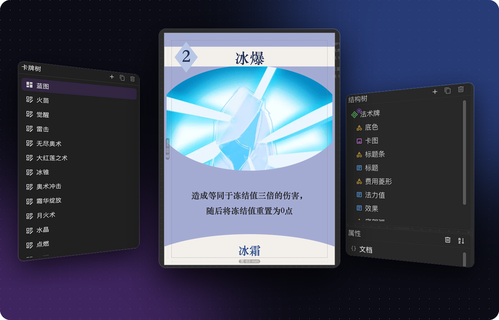
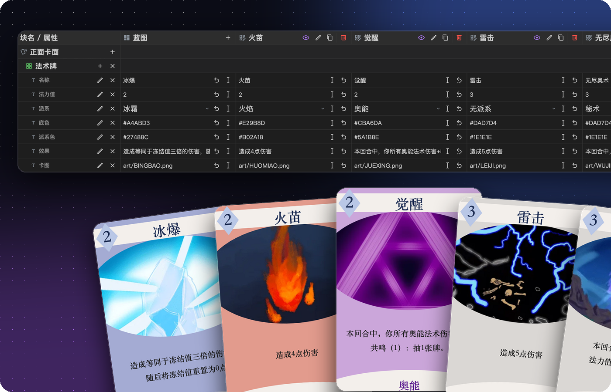
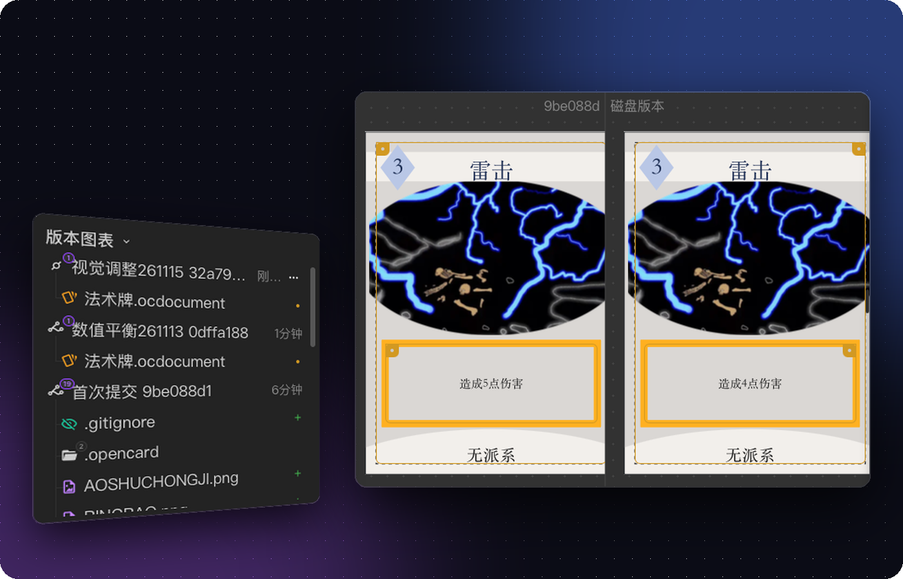
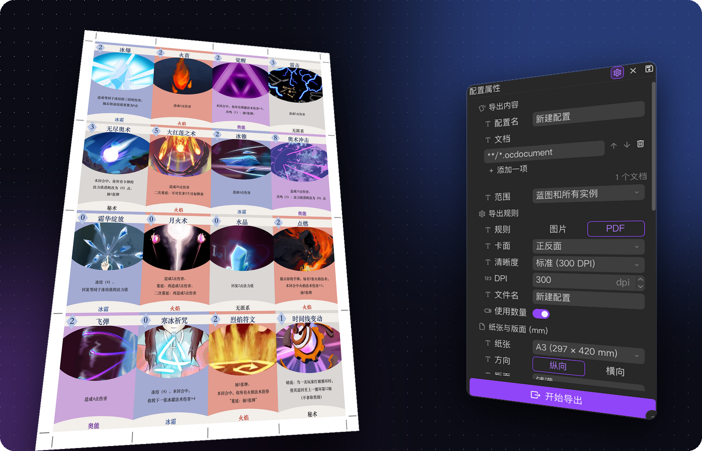

<p align="center">
  
</p>

<p align="center">
  <strong>设计一次蓝图，批量填充卡牌｜字体、图标、文本集中管理｜导出图片与拼版 PDF</strong>
</p>

<p align="center">
  <a href="https://github.com/OpenC4rd/OpenCard/actions/workflows/verify.yml"></a>
  <a href="https://github.com/OpenC4rd/OpenCard/releases/latest"></a>
  <a href="LICENSE"></a>
  
</p>

<p align="center">
  
</p>

OpenCard 是面向桌游设计师的桌面工作台，把版式设计、卡牌内容和批量实例放在同一个项目里。它延续了 **CardEditor → EzCardDotNet → OpenCard** 的迭代，一路积累了上千名桌游设计师与自制桌游爱好者。

> [!NOTE]
> OpenCard 还在早期阶段，文件格式和交互细节可能在后续版本调整。升级前请备份项目，或用内置的存档点留一份可回退的版本。遇到问题欢迎[提 Issue](https://github.com/OpenC4rd/OpenCard/issues)。

## 特性

<table>
  <tr>
    <td width="40%" valign="top">
      <h3>蓝图与实例</h3>
      <p>蓝图定义一套卡牌共用的结构和版式，实例只填每张卡的差异。改一次蓝图，整套卡跟着变。</p>
      <p>画布、结构树和属性面板协同编辑文字、图片、形状、二维码和容器，支持富文本、正反面与出血。</p>
    </td>
    <td width="60%"></td>
  </tr>
  <tr>
    <td width="40%" valign="top">
      <h3>数据表</h3>
      <p>把同一蓝图的所有实例摊成一张表，像填表格一样批量录入和修改内容，旁边实时预览。</p>
    </td>
    <td width="60%"></td>
  </tr>
  <tr>
    <td width="40%" valign="top">
      <h3>版本管理</h3>
      <p>基于 Git 的存档点和版本图表。卡牌可以和任意存档点并排对比，改动的块直接标出来；也可以撤销、回退，或单独恢复某个文件。</p>
    </td>
    <td width="60%"></td>
  </tr>
  <tr>
    <td width="40%" valign="top">
      <h3>拼版导出</h3>
      <p>导出图片或拼版 PDF，带预览、水印、页面信息与出血。一个项目可以保存多份导出配置。</p>
    </td>
    <td width="60%"></td>
  </tr>
</table>

另外还有：字体、图标集、自定义块和全局字典等项目资源，精灵图可以直接裁成图标；资源包的打包与安装；深浅色主题、中英文界面，以及内置的引导和教程。

OpenCard 适合“同一套设计需要反复填充”的项目。它不是通用的图片编辑器，也不是在线协作平台。

## 下载

在 [Releases](https://github.com/OpenC4rd/OpenCard/releases/latest) 下载对应平台的安装包：

| 平台 | 安装包 |
| --- | --- |
| macOS（Apple 芯片） | `.dmg` |
| Windows（x64） | `-setup.exe` 或 `.msi` |
| Linux（x64） | `.AppImage`、`.deb` 或 `.rpm` |

应用内可以检查并安装更新。

## 快速开始

1. 创建或打开项目。项目就是一个普通文件夹，左侧文件树定位文档，中间是编辑区。
2. 新建卡牌文档，先在蓝图里搭好结构和版式。
3. 从蓝图创建实例，在设计视图或数据表里填入每张卡的内容。
4. 把字体、图标和重复文案登记为项目资源，在卡牌里引用。
5. 在导出空间预览版面，导出图片或拼版 PDF。

第一次打开时，应用里的“界面介绍”和“创建第一个项目”引导会带你走一遍。

## 三个概念

| 概念 | 解决的问题 | 对你的意义 |
| --- | --- | --- |
| **蓝图** | 哪些结构和版式应该共享 | 修改一次，影响同一套卡牌的共同设计 |
| **实例** | 每张卡具体填入什么内容 | 保持统一版式的同时，维护每张卡的差异 |
| **项目资源** | 字体、图标和重复文本如何复用 | 集中管理，减少重复导入和手工修改 |

## 仍在开发

- 面向最终使用者的发布流程
- 网络联机式项目测试
- 在线协作与云端同步

这些不是当前版本的隐藏承诺，项目目前以单机工作流为主。

## 从源码构建

需要 Node.js、npm 和 [Tauri 2 的本地开发环境](https://tauri.app/start/prerequisites/)。

```bash
git clone https://github.com/OpenC4rd/OpenCard.git
cd OpenCard/opencard-app
npm install
npm run tauri dev     # 桌面应用
npm run dev           # 只开 Vite 开发服务器
npm run verify        # 提交前检查：架构与界面 lint、类型检查、测试
```

Rust 侧的测试在 `opencard-app/src-tauri` 下跑 `cargo test`。

```text
OpenCard/
├─ opencard-app/       # Vue 3 + Tauri 2 应用
├─ services/           # 反馈服务（Cloudflare Worker）
├─ docs/               # 项目文档
└─ AGENTS.md           # 给 agent 的协作规矩
```

## 社区

- 问题反馈：[GitHub Issues](https://github.com/OpenC4rd/OpenCard/issues)
- QQ 群：[OpenCard 桌游交流群](http://qm.qq.com/cgi-bin/qm/qr?_wv=1027&k=MJD18YzJxqft6Q6rKX-sSNiLrtmqVQmJ&authKey=TM3En%2BxxzFeqimSCUhG%2F5VLmfRDeXtnfm1h6P7cwfoGR6bVXkXk2cYm%2BOG0MHuJ8&noverify=0&group_code=567915181)（1200+ 人）
- 开发者动态：[Bilibili](https://space.bilibili.com/271218438)

## 许可

OpenCard 以 [Apache License 2.0](LICENSE) 发布。
