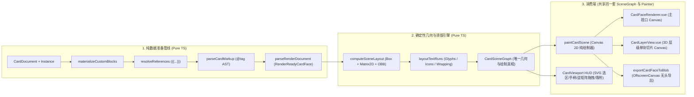

# OpenCard 卡片渲染系统重构设计方案

> [!IMPORTANT]
> 本方案旨在彻底终结现有卡片渲染系统「依赖浏览器 DOM 反向测量（`getBoundingClientRect` + 临时关闭 `transform`）」与「依赖 `dom-to-image-more`（SVG `foreignObject`）黑魔法截图导出」两大病根，转向 **前端纯 TypeScript 确定性几何布局树 + Canvas 2D 统一渲染引擎 + `@tag` 无歧义富文本语法**。

---

## 1. 核心共识与重构目标

### 1.1 我们已达成的架构共识

| 决策维度 | 最终共识方案 | 废弃的旧设计 |
| :--- | :--- | :--- |
| **前后端分工** | **前端纯 TS 确定性几何布局 + Canvas 2D 统一绘制**；Rust 专注字体/图片底层探测与导出并发写盘 | 废弃 Vue DOM 组件树渲染卡片（`TextBlockRenderer.vue` 等 8 个 DOM 块组件） |
| **几何与盒模型** | 尺寸与坐标收紧为纯数学可解的 **物理单位（`mm`、`pt`、`cm`、`in`）、`%`（相对父容器）及四则运算**；**彻底移除 `customCss` 与像素 `px`** | 废弃任意未受控单位（`auto`/`vw`/`em` 等）、自由注入 `customCss` 与屏幕像素 `px` |
| **块变换与选区** | 保留 `translateX/Y`、`scaleX/Y`、`rotation`、`transformAnchor`；通过 2D 仿射矩阵直接计算有向包围盒（OBB）；**彻底废除 `transformDisabledBlockIds`** | 废弃选中块时临时关闭块及祖先容器变换的 `transformDisabledBlockIds` 与 `getBoundingClientRect` 测量 |
| **文本块收敛** | **移除独立的 `markdown-text-block`**，统一收敛为单一 `text-block`（不含 HTML `<table>`） | 废弃 `markdown-text-block`、`markdown-it` 卡片渲染链路及 HTML `<table>` 富文本 |
| **富文本未来扩展** | 底层采用「**字元/切片排版（Positioned Glyphs/Runs）+ 多通道绘制（Multi-pass Painter）**」，未来新增「艺术字 / 沿路径文字块」直接复用同一底层管线 | 告别 CSS `-webkit-text-stroke` 无法圆角外描边、无法沿曲线排布的限制 |
| **富文本真相语法** | 采用独创 **`@tag(arg=val,...){content}`** 语法；纯文本零标签，自然换行 `\n` 分段；`{{...}}` 绑定最高词法优先级；资源引用拆解为命名参数 `@icon(key=..., pkg=..., version=...)`；属性面板保留可视化编辑器并做双向转换 | 废弃在 `.ocdocument` JSON 和 `.xlsx` 数据表中直接存储脏 HTML 标签汤（`
`） |
| **外观与绘制抽象** | `background` 升级为 `color` 字段（接入取色器）；所有颜色绘制统一经过 `PaintStyle` 抽象（未来一键扩展线性/径向渐变与材质贴图）；块边框统一为 **Canvas 内描边（Inside）** | 废弃 `background` 纯字符串无取色器、废弃用 CSS `outline` 充当外边框导致满铺裁切 |
| **导出与 3D 视图** | 导出采用 **纯内存 `OffscreenCanvas` 无头渲染**，与主视口 100% 调用同一套绘制函数；`CardLayerView` 每个 3D 平面改为单块 `<canvas>` 切片绘制 | **彻底卸载 `dom-to-image-more`**、删掉工作台隐藏导出 DOM 节点、`inlineProjectIconSources` 及 `CardLayerView` 的 `cloneNode/innerHTML` 快照 |

### 1.2 要达成的可量化目标
1. **零几何错位**：任意旋转（`rotation`）、缩放（`scaleX/Y`）、嵌套容器、9 宫格锚点（`anchor` / `transformAnchor`）下，选中块时画面 **0 跳动**，选区框、八方向控制点、旋转手柄、对齐吸附线与画面像素 **100% 严丝合缝**。
2. **100% 所见即所得导出**：视口画布与导出的 PNG 图片调用同一个 `paintCardFace()` 函数，字体、遮罩（`maskSource`）、内联图标、圆角裁剪在不同倍率（1x / 2x / 4x）下 **100% 像素级一致**，彻底清零导出丢图/丢遮罩/丢字体 Bug。
3. **代码大幅瘦身**：用约 **800~1000 行纯函数式 TS 布局与 Canvas 绘制代码**，替换掉现有的 8 个 Vue 块渲染组件、[CardViewport.vue](file:///Users/popcornboom/Documents/GitHub/OpenCard/opencard-app/src/features/card-rendering/components/CardViewport.vue) 中近千行的 DOM 测量补丁、[CardLayerView.vue](file:///Users/popcornboom/Documents/GitHub/OpenCard/opencard-app/src/features/card-rendering/components/CardLayerView.vue) 的 DOM 克隆逻辑以及 [useProjectExport.ts](file:///Users/popcornboom/Documents/GitHub/OpenCard/opencard-app/src/features/shell/composables/useProjectExport.ts) 的 DOM 截图黑魔法。

---

## 2. 模块架构与职责边界

### 2.1 模块目录规划与边界约束

所有卡片渲染核心模块集中在 `opencard-app/src/features/card-rendering/` 下，按职责划分为 **5 个纯 TS 子域** 和 **1 个精简组件层**：

| 模块路径 | 单一职责 | 严禁越界行为（边界铁律） |
| :--- | :--- | :--- |
| **`geometry/`** `lengthMath.ts` `matrix2d.ts` `sceneLayout.ts` `hitTest.ts` | 1. 解析物理长度（`mm`/`pt`/`cm`/`in`）、`%`/四则运算长度； 2. 计算 2D 仿射变换矩阵 `Matrix2D` 与逆矩阵； 3. 计算 `simple-container` 锚点定位与 `flow-container` 流式排布； 4. 输出含 `localRect`、`worldMatrix`、`obbCorners`、`aabb` 的 `CardSceneGraph`； 5. 提供点选/框选射线检测与父坐标系逆投影。 | **严禁访问任何 DOM API（`window`/`HTMLElement`）或 Vue 响应式状态**；必须是可在 Node 环境直接单测的纯数学函数。 |
| **`markup/`** `cardMarkupLexer.ts` `cardMarkupParser.ts` `cardMarkupSerializer.ts` `tiptapBridge.ts` | 1. 解析 `@tag(k=v){content}` 与 `{{binding}}` 生成 `CardMarkupDocument` AST； 2. 将 AST 序列化回规范的 `@tag` 字符串； 3. 提供与可视化编辑器（TipTap `OcRichTextEditor`）JSON 文档的双向无损转换。 | **严禁依赖浏览器 `DOMParser` 或拼接 HTML 字符串**；解析器必须 100% 容错（未闭合或未知标签降级为普通文本并产出诊断，绝不抛异常崩溃）。 |
| **`text-layout/`** `glyphMeasurer.ts` `inlineRunBreaker.ts` `textBlockLayout.ts` | 1. 将 `CardMarkupDocument` 展开为扁平样式切片（`StyledTextRun` / `InlineIconRun` / `InlineImageRun`）； 2. 支持横排（`horizontal-tb`）与竖排（`vertical-rl`/`lr`）折行、对齐（`start/center/end/justify`）与垂直对齐； 3. 输出每个字元/图标的精确坐标与角度（为未来路径文字预留变换钩子）。 | 通过注入的 `TextMeasurePort` 测量字宽（浏览器环境用离屏 Canvas `ctx.measureText`，Node 单测环境用确定性等宽/字表替身），**不直接操作视图 Canvas**。 |
| **`painter/`** `paintStyle.ts` `canvasAssetStore.ts` `paintCardScene.ts` `painters/*.ts` | 1. `paintStyle.ts`：统一将颜色（及未来的渐变/纹理）转换为 `CanvasFillStrokeStyles`； 2. `canvasAssetStore.ts`：管理已解码的 `ImageBitmap`/`HTMLImageElement` 与字体就绪状态； 3. `paintCardScene.ts`：按 `CardSceneGraph` 绘制卡面背景、容器裁剪、内描边、图形、二维码、带遮罩图片、多通道富文本。 | **只读取 `CardSceneGraph` 与 `CanvasAssetStore` 向传入的 `CanvasRenderingContext2D` 绘图**；不修改数据模型，不自行发起业务层文件读取。 |
| **`export/`** `renderFaceToPng.ts` | 接收 `CardSceneGraph` + 资源上下文 + 倍率 `scale`，在内存 `OffscreenCanvas` 上调用 `paintCardScene` 并输出 `Uint8Array` PNG 字节流。 | **不挂载任何 DOM 节点**，不依赖任何全局单例 Vue 组件。 |
| **`components/`** `CardFaceRenderer.vue` `CardViewport.vue` `CardLayerView.vue` | 1. `CardFaceRenderer.vue`：极薄的 `<canvas>` 包装器（处理 `devicePixelRatio` 与重绘调度）； 2. `CardViewport.vue`：管理画布平移缩放，用 SVG 渲染 `CardSceneGraph` 的选区 OBB、手柄与吸附线； 3. `CardLayerView.vue`：每个 3D 层平面用 `<canvas>` 调用 `paintSceneNode` 绘制单块切片。 | **严禁在组件中调用 `getBoundingClientRect()` 测量块尺寸**；严禁使用 `v-html` 或 `cloneNode` 渲染卡片内容。 |

### 2.2 需要彻底删除的旧文件与依赖
- **卸载 NPM 包**：`dom-to-image-more` 及 `opencard-app/src/types/dom-to-image-more.d.ts`
- **删除旧 DOM 块渲染组件**：
  - [NativeBlockRenderer.vue](file:///Users/popcornboom/Documents/GitHub/OpenCard/opencard-app/src/features/card-rendering/components/NativeBlockRenderer.vue)
  - [TextBlockRenderer.vue](file:///Users/popcornboom/Documents/GitHub/OpenCard/opencard-app/src/features/card-rendering/components/TextBlockRenderer.vue) 及 `TextBlockRenderer.spec.ts`
  - [MarkdownTextBlockRenderer.vue](file:///Users/popcornboom/Documents/GitHub/OpenCard/opencard-app/src/features/card-rendering/components/MarkdownTextBlockRenderer.vue) 及 `MarkdownTextBlockRenderer.spec.ts`
  - [ImageBlockRenderer.vue](file:///Users/popcornboom/Documents/GitHub/OpenCard/opencard-app/src/features/card-rendering/components/ImageBlockRenderer.vue) 及 `ImageBlockRenderer.spec.ts`
  - [ShapeBlockRenderer.vue](file:///Users/popcornboom/Documents/GitHub/OpenCard/opencard-app/src/features/card-rendering/components/ShapeBlockRenderer.vue)
  - [QrCodeBlockRenderer.vue](file:///Users/popcornboom/Documents/GitHub/OpenCard/opencard-app/src/features/card-rendering/components/QrCodeBlockRenderer.vue) 及 `QrCodeBlockRenderer.spec.ts`
  - [SimpleContainerBlockRenderer.vue](file:///Users/popcornboom/Documents/GitHub/OpenCard/opencard-app/src/features/card-rendering/components/SimpleContainerBlockRenderer.vue)
  - [FlowContainerBlockRenderer.vue](file:///Users/popcornboom/Documents/GitHub/OpenCard/opencard-app/src/features/card-rendering/components/FlowContainerBlockRenderer.vue)
  - [CustomBlockRenderer.vue](file:///Users/popcornboom/Documents/GitHub/OpenCard/opencard-app/src/features/card-rendering/components/CustomBlockRenderer.vue)
  - [richTextDocumentRenderer.ts](file:///Users/popcornboom/Documents/GitHub/OpenCard/opencard-app/src/features/card-rendering/components/richTextDocumentRenderer.ts)
  - [blockRenderPlacement.ts](file:///Users/popcornboom/Documents/GitHub/OpenCard/opencard-app/src/features/card-rendering/components/blockRenderPlacement.ts) 与 [blockStyle.ts](file:///Users/popcornboom/Documents/GitHub/OpenCard/opencard-app/src/utils/blockStyle.ts)
  - [renderMarkdown.ts](file:///Users/popcornboom/Documents/GitHub/OpenCard/opencard-app/src/features/card-rendering/markdown/renderMarkdown.ts) 及 `renderMarkdown.spec.ts`

---

## 3. 关键技术规格说明

### 3.1 确定性长度解析与 2D 仿射矩阵（`geometry/`）

1. **长度表达式语法（`resolveLength(expr: string, parentSpan: number): number`）**：
   - 支持纯数字/默认单位 `mm`（如 `63`、`63mm` $\to 63$）、物理单位 `pt`、`cm`、`in`、百分比 `%`（如 `50%` $\to 0.5 \times \text{parentSpan}$），以及包含 `+`、`-`、`*`、`/`、括号或可选 `calc(...)` 外壳的线性组合（如 `50% - 4mm`、`calc(100% - 10mm)`）。彻底移除像素 `px` 单位。
   - 解析失败时由 `renderParser` 记录诊断并回退到字段默认值，进入 `geometry/` 时保证 100% 可求值为有限浮点数 `number`。
2. **容器布局求值**：
   - **`simple-container-block`**：根据子块 `width`/`height`（相对容器宽高）和 `location.anchor`（`lt/ct/rt/lc/cc/rc/lb/cb/rb`）+ `location.x/y`，直接算出子块在父容器局部坐标系下的未变换矩形 `localRect = { x, y, width, height }`：
     - 水平方向：`l` $\to x$；`c` $\to \frac{W_{\text{parent}} - W_{\text{child}}}{2} + x$；`r` $\to W_{\text{parent}} - W_{\text{child}} - x$。
     - 垂直方向：`t` $\to y$；`c` $\to \frac{H_{\text{parent}} - H_{\text{child}}}{2} + y$；`b` $\to H_{\text{parent}} - H_{\text{child}} - y$。
   - **`flow-container-block`**：按 `location.index` 升序排列可见子块，根据 `direction`（`lr/rl/tb/bt`）与 `gap` 累加主轴偏移，根据 `location.align`（`start/center/end/justify`）计算交叉轴位置（`justify` 时交叉轴尺寸拉伸为父容器交叉轴尺寸）。
3. **2D 仿射矩阵与逆矩阵交互**：
   - 每个块相对于父容器的局部变换矩阵 $M_{\text{local}}$（围绕锚点 $P = (p_x, p_y)$）：
     $$M_{\text{local}} = T(x + p_x + t_x,\, y + p_y + t_y) \cdot R(\theta) \cdot S(s_x, s_y) \cdot T(-p_x, -p_y)$$
   - 世界矩阵：$M_{\text{world}} = M_{\text{parent}} \cdot M_{\text{local}}$。
   - **拖拽与缩放逆投影**：鼠标在卡面世界坐标的移动量 $\Delta P_{\text{world}}$，通过乘以 $M_{\text{parent}}^{-1}$ 投影到父容器局部空间更新 `location.x/y`；缩放手柄拖拽时通过乘以 $M_{\text{world}}^{-1}$ 投影到块的自身局部正交空间更新 `width/height`，**永远不需要关闭 `transform`！**

### 3.2 `@tag(arg=value,...){content}` 富文本语法规格（`markup/`）

1. **词法优先级（LL(2) 状态机）**：
   - **最高优先级 `{{...}}`**：遇到连续两个 `{{` 立即进入绑定词法，读取至 `}}` 产出 `BindingNode`（即使写在 `@b{{{damage}}}` 中，第一个 `{` 开启 `@b` 块，紧接着的 `{{damage}}` 被识别为绑定节点，最后一个 `}` 闭合 `@b`）。
   - **指令触发 `@name`**：`@` 后紧跟合法指令名且紧跟 `(` 或 `{`（或独立指令 `@br`）时触发指令；进入 `(...)` 后切换为参数词法状态（内部允许出现任意字符，支持引号包裹或无引号键值，直到 `,` 或 `)`）。
   - **转义序列**：`\@`、`\{`、` text \}`、`\\`。
   - **自然分段**：顶层文本中的 `\n` 直接切分为段落（`ParagraphNode`）。
2. **标准指令集**：
   - **行内布尔修饰（带 `{content}`）**：`@b{...}`、`@i{...}`、`@u{...}`、`@s{...}`
   - **行内样式修饰（带 `(args){content}`）**：
     - `@style(color=#ff4d4f, bg=#ffff00, size=5mm, font=font:title, stroke=#000000 0.5mm, shadow=#000000 0.5mm 0.5mm 1mm, fill=assets/gold.png){...}`
     - 常用语法糖简写：`@color(#ff4d4f){...}`、`@size(5mm){...}`、`@font(font:title){...}`、`@mark(color=#ffff00){...}`
   - **块级/段落指令（带 `{content}`）**：
     - `@align(center|start|end|justify){...}`
     - `@ul{@li{...} @li{...}}`、`@ol{@li{...} @li{...}}`
   - **自闭合内联叶子指令（只带 `(args)`，无 `{content}`）**：
     - 图标：`@icon(mana/fire)` 或 `@icon(key=mana/fire, pkg=author/name, version=1.0.0, size=1.2em)`（`scope=host` 表示宿主项目）
     - 图片：`@img(src=assets/coin.png, w=10mm, h=10mm, fit=contain, align=center)`
     - 段内强制换行：`@br`

### 3.3 Canvas 2D 统一绘制细节（`painter/`）

1. **统一 `PaintStyle` 抽象**：
   - `resolveCanvasPaintStyle(ctx, value, rect)`：当前解析纯色字符串（`#hex`、`rgb/rgba`、`hsl`、`transparent`），接口预留 `LinearGradientSpec | RadialGradientSpec | PatternSpec`，未来扩展渐变只需修改此函数。
2. **块背景、圆角与内描边（Inside Border）**：
   - 若块存在 `background`、`borderWidth > 0` 或 `clip === true`，构造 `roundRect(0, 0, w, h, radius)` 路径：
   - 绘制 `borderWidth > 0` 时，先 `ctx.save(); ctx.clip(outerRoundRect)`，再以 `lineWidth = borderWidth * 2` 沿 `outerRoundRect` 描边——利用 `clip` 天然实现 **100% 精确的内描边（Inside Stroke）**，绝不向块外溢出半个像素！
3. **图片与图标遮罩（`maskSource` & `tint: 'context'`）**：
   - 替代以前脆弱的 CSS `-webkit-mask-image`：在离屏小缓冲 Canvas（或当前层）先画原图，再设置 `ctx.globalCompositeOperation = 'destination-in'` 画遮罩图，100% 跨平台一致且无需 Base64 内联黑魔法。
4. **富文本多通道绘制（Multi-pass Glyph/Run Painter）**：
   - 对每一行排好坐标的 `PositionedRun` 依次执行：
     1. **背景高亮通道**（`bg` / `@mark`）
     2. **阴影与外描边通道**（设置 `ctx.lineJoin = 'round'; ctx.miterLimit = 2`，先 `strokeText` 再 `fillText`，彻底解决文字描边吃字问题）
     3. **主填充通道**（纯色 `fillText` 或图案纹理 `createPattern` 填充，及内联图标/图片绘制）
     4. **装饰线通道**（下划线 `u` / 删除线 `s`）

---

## 4. 任务拆解、难度分级与多模型派单指南（成本优化）

为了最大化节省 Token 成本并保证核心算法质量，我们将整个重构拆解为 **7 个独立可验证的工作包（Work Packages, WP1 ~ WP7）**，按难度精准分配给 **Opus 5.5**、**GPT** 和 **DeepSeek V4.1 Flash**：

| 阶段与编号 | 工作包名称 | 复杂度 | 推荐分配模型 | 分配理由与关键交付物 |
| :--- | :--- | :---: | :---: | :--- |
| **WP1** 模型与契约清理 | 移除 `customCss` 与 `markdown-text-block`，升级 `background` 为 `color` | ⭐ 简单 | **DeepSeek V4.1 Flash** | **纯规则机械改造**：修改 `model.ts`、`schema.ts`、`render.types.ts`、`renderFieldContracts.ts`、`renderParser.ts`、`useCdeTreeOps.ts` 及中英文 i18n，清理对应旧单测。边界极清晰，Flash 模型性价比最高。 |
| **WP2** 数学几何与场景布局引擎 | `geometry/`：确定性长度计算、2D 仿射矩阵、容器布局、OBB 与逆矩阵 Hit-Test | ⭐⭐⭐ 高难 | **Opus 5.5** | **核心数学地基**：涉及 9 宫格锚点、流式容器排布、2D 矩阵求逆、旋转缩放下的局部/世界坐标双向投影及拖拽缩放不动点反算。由 Opus 一次性写透并配齐纯 Node 完备单测。 |
| **WP3** `@tag` 富文本解析器与编辑器桥接 | `markup/`：`@tag` LL(2) 词法/语法解析器、序列化器与 TipTap 双向转换 | ⭐⭐⭐ 高难 | **Opus 5.5**（解析器） + **GPT**（TipTap 桥接） | **核心文法与容错**：`cardMarkupLexer/Parser` 需处理 `{{...}}` 前瞻、参数区隔离、错误恢复与诊断定位，适合 Opus；`tiptapBridge.ts` 属于结构化 AST 映射与 UI 对接，交给 GPT 高效完成。 |
| **WP4** 富文本排版与 Canvas 2D 绘制引擎 | `text-layout/` 图文混排折行（横/竖排） + `painter/` 统一 Canvas 绘制器 | ⭐⭐⭐ 高难 | **Opus 5.5**（文本排版） + **GPT**（基础块绘制） | **核心视觉引擎**：图文混排折行（含内联图标、字号混排基线对齐、竖排 `vertical-rl/lr`）算法密集，由 Opus 攻坚；容器/图形/二维码/图片遮罩绘制（`painters/*`）逻辑直观，由 GPT 实现。 |
| **WP5** 无头导出与 3D 层级视图替换 | `export/` OffscreenCanvas 导出 + `CardLayerView.vue` 单块 Canvas 化 + 卸载 `dom-to-image-more` | ⭐⭐ 中等 | **GPT** | **标准工程整合**：有了 WP4 的 `paintCardScene` 后，重写 `useProjectExport.ts` 和 `CardLayerView.vue` 就是直接调用现成绘制函数并删掉旧 DOM 克隆代码，GPT 最擅长此类模块替换。 |
| **WP6** 视口重构与旧组件清理 | 重写 `CardFaceRenderer.vue` 与 `CardViewport.vue` 数学交互，删除 8 个旧 Vue 块组件 | ⭐⭐⭐ 较难 | **Opus 5.5** 或 **GPT** | **交互手感收口**：废除 `transformDisabledBlockIds` 和 `getBoundingClientRect`，把选区框、旋转/缩放手柄、吸附线接到 WP2 的 `CardSceneGraph` 上，并彻底删除旧 DOM 渲染组件。 |
| **WP7** 死代码清扫与文档/Release Notes | 清理残留引用、更新 `docs/工程规则.md` 与 `RELEASE_NOTES.md`、全量测试回归 | ⭐ 简单 | **DeepSeek V4.1 Flash** | **收尾清扫**：全仓检索残留死代码、跑通类型检查与测试套件、按规范更新文档，Flash 模型可快速低成本完成。 |

---

## 5. 如何高效调试与验证（Debugging & Verification Playbook）

重构过程中严禁「盲写几千行最后打开窗口看黑屏」，必须采用以下三层高效调试手段：

### 5.1 第一层：毫秒级 Node 纯逻辑单测（无需启动浏览器/Tauri）
- `geometry/`、`markup/`、`text-layout/` 全部声明 `// @vitest-environment node`。
- **文本排版替身测试**：在 Node 单测中注入确定性 `MockTextMeasurer`（例如：ASCII 字符宽 `0.5 * fontSize`，CJK 汉字宽 `1.0 * fontSize`），即可在 **10ms 内**用纯数字断言折行位置、行高、基线偏移、内联图标坐标与竖排坐标，无需肉眼比对截图！
- **矩阵逆变换不变量测试**：在单测中直接验证「任意旋转 $\theta$ + 缩放 $(s_x, s_y)$ + 父容器嵌套下，拖动右下角手柄 $(\Delta x, \Delta y)$ 后，块的左上角锚点在世界坐标系下的位置误差 $< 10^{-6}$」。

### 5.2 第二层：Canvas 内置可视化调试图层（Debug Overlay 开关）
在 `paintCardScene(ctx, scene, assets, { debug?: SceneDebugOptions })` 中内置一个轻量调试绘制开关（开发模式下可通过快捷键或属性开启）：
- **`showLayoutBoxes`**：用绿色细线画出每个块的未变换 `localRect`，用品红色画出变换后的 `OBB` 四角框与旋转中心点（`transformAnchor`），一眼看出矩阵变换是否准确。
- **`showTextBaselines`**：用青色细线画出富文本每一行的 `baseline`、上沿（`ascent`）、下沿（`descent`）以及每个 `@icon` 的占位框，秒级定位图文混排对齐问题。

### 5.3 第三层：视口与导出同源一致性校验
- 因为 `CardFaceRenderer.vue` 和 `exportCardFaceToBlob()` 调用的是**同一个 `paintCardScene()` 函数**，调试导出时无需走完整的文件弹窗流程，直接在控制台或单测中调用 `renderFaceToPng(scene, 2)` 即可拿到 PNG Buffer 验证导出结果。
