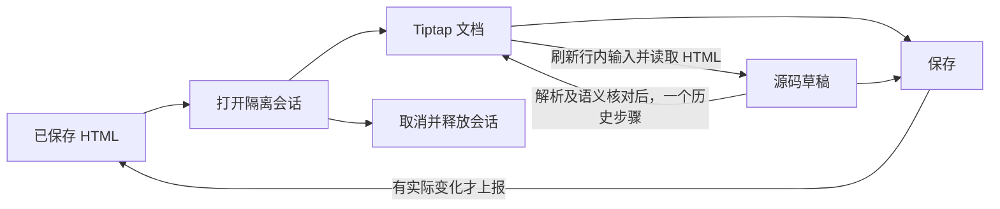

# 富文本编辑器内部架构

界面沿用现有两行工具栏、右侧属性区、行内节点和源码切换。外部字段接口仍是 `definition/value`、`update:value` 与 `activate()`。

## 数据所有权

| 数据 | 所有者 | 写入边界 |
| --- | --- | --- |
| 已保存 HTML | 调用方字段 | 用户保存时，至多上报一次 |
| 可视化内容、历史、选区 | 当前 Tiptap 实例 | 编辑器事务 |
| 源码草稿 | `useRichTextSession` | 源码模式的用户输入 |
| 格式值 | `useRichTextFormatting` | 从文档和选区派生，区分未设置、单值、混合值 |
| 浮层操作目标 | `richTextInteraction` | 捕获选区 bookmark，随事务映射，失效即释放 |
| 颜色预览 | 编辑器插件 | decoration，不写入内容或撤销历史 |
| 字体和图片的运行时解析结果 | 资源环境 | 仅用于显示，不进入文档 |

打开时的原文及对应不可变文档、最近一次源码交接的原文及对应不可变文档，只是读取基线。它们不接受用户编辑，也不与当前文档双向同步。当前文档回到某个基线时，读取对应原文，避免无修改保存重写 HTML。

## 内容生命周期

- 切换模式保留同一个编辑器实例。没有修改的切换不生成历史；源码修改交接以一个独立历史步骤替换文档。
- 保存前刷新正在编辑的 Binding。中文组合输入尚未完成时，暂不交接或保存；取消不提交草稿。
- HTML 只在初始化、交接和保存等边界转换。按键操作不序列化 HTML，也不经父组件回传重建文档。
- 不能保留现有内容语义时继续显示源码和原因，保留原文；不因此拒绝整个文档。源码保存沿用原有安全校验。
- 切换模式、取消和关闭都结束临时格式交互；关闭后创建的新会话不复用旧草稿或异步结果。

## 格式交互

1. 从编辑区进入工具栏、侧栏或浮层时捕获原选区，覆盖鼠标及键盘聚焦。
2. 工具栏和侧栏共享格式投影。只写用户指定的字段，不用混合值的显示回退重写相邻属性。
3. 命令通过统一的交互入口执行。bookmark 恢复原选区类型，避免把图标或表格选区转换成文本选区。
4. 颜色预览只添加显示 decoration；提交才写入正式事务，取消只清除 decoration。
5. 新选区结束旧操作目标；文档修改映射目标，目标消失或选区类型失效时释放。

光标格式由引擎的 `storedMarks` 优先提供，否则读取当前位置的 marks：文字边界通常取前一个字符，段落开头取该位置可继承的格式，空段落取基础格式。移动光标由引擎清除先前的临时输入格式，不建立第二份可写格式状态。

选区按属性分别求共同值，继承字号和等价 CSS 颜色参与有效值比较；混合值只在控件中显示为空白或混合提示。选区改色只写颜色，不写字号等相邻属性。普通输入与替换选区沿用引擎的输入 marks；替换选区从首个选中字符继承格式，而不是从选区外的前一个字符取值。格式读取和显示回退均不得修改文档。

`PropertyFieldRenderer` 已有字段级预览/取消事件；`PropertyEditor` 只透传为 `preview-property` / `cancel-property` 意图，不维护富文本草稿。既有 `update-property` 仍表示正式提交。

## 模块边界

- `OcRichTextEditor.vue`：组装原有工具栏、编辑区与属性控件。
- `OcDialog`：公开默认、`footer`、`sidebar` 插槽、`sidebar` 开关、`v-model:open` 与可选 `v-model:sidebar-open`；`OcDialogLayout` 是其内部布局，复用 CDE 所用的 `OcResizeTrack`。侧栏位于完整主窗口的外部右侧，主窗口与侧栏共用一个模态焦点范围。富文本通过公开的只读属性投影及格式命令组装侧栏，不再持有任何侧栏布局。弹窗主窗口使用现有 `xl` 尺寸预设。
- `useRichTextEditor`：创建编辑器、编排格式及资源操作，提供读取 HTML、应用源码、刷新行内输入、聚焦和结束交互的内部接口。
- `useRichTextSession`：单次窗口会话、模式及保存/取消。
- `useRichTextFormatting` / `richTextInteraction`：格式读取与命令、选区及临时显示。
- `richTextStyleExtensions` / `richTextEditorHtml`：编辑词汇表、动态样式和稳定字体引用的边界转换。数据属性形式的填充与阴影同样属于字符样式，不要求额外的 `style` 属性。
- `BindingNodeView`：行内输入草稿；复用 `usePropertyCompletion`，取消、失焦和卸载时废弃迟到结果。
- `richTextHtml`：安全渲染投影和诊断。`renderRichTextDocument` 统一字段预览和卡片渲染的遍历及行内格式组合，调用方只提供资源环境与图标显示。
- `richTextResourceStyle`：编辑区、字段预览和卡片渲染共用的绘制投影，将字形填充与背景合成独立的 CSS 背景层；资源解析服务由各自环境提供。
- `richTextTable`：统一单元格跨度、列宽与编辑交接的布局语义；表格自动生成的列组和最小宽度不作为内容差异。无法表达的自定义布局仍由源码交接核对保留。

格式投影保留未设置、单值、混合值，并单独记录是否存在显式设置；属性字段通过 `valueState` 和显示提示消费这些状态，不把提示写入文档。属性区按编辑顺序排列；选区标题区分光标、文本、节点与单元格。

## 字符格式与绘制

| 概念 | 唯一文档表示 | 命令的修改范围 |
| --- | --- | --- |
| 纯色前景色 | textStyle.color，纯色模式不保存额外标记 | 修改颜色并退出图片模式 |
| 图片前景色 | textStyle.textFillType=image，图片引用由 textFillSource 保存 | 只修改前景色，退出图片模式时清除图片引用 |
| 文字背景 | 原生 highlight mark | 只修改背景，透明色清除背景标记 |
| 描边／阴影 | textStyle 对应属性 | 只修改对应效果 |

工具栏与侧栏共享这些命令；前景色与背景色是独立的格式。前景色只有纯色与图片，不提供“无填充”。光标上的命令只设置原生输入 marks，选区上的命令修改选中内容。

渲染时，行内背景与前景色沿嵌套结构传递，在最终文字处合成，使用该处的实际字号；段落和单元格背景仍保留块级布局语义。图片层裁剪到字形，背景层覆盖文字所在行框。图片未解析时保留正常文字颜色。

侧栏直接使用公共 PropertyEditor 的字段 Key 复制、原始字符串模式和 reset-property 操作，与 CDE 共用 Action Rail，不增加富文本专用按钮。分类提供语境，字段标题只显示“名称”“大小”“颜色”等；机器 Key 保留 fontSize、foregroundColor、shadowColor 等明确含义。

字号显示与单位回退只由格式 state 负责，工具栏及属性记录直接读取该值，不再二次覆盖。描边及阴影的固定长度候选由数值数组一次生成，不使用无依赖 computed，也不携带未消费的 value。

reset-property 清除对应的显式属性，绝不写入显示回退值；即使显式值等于继承值，也显示重置按钮。清除 textAlign 使用原生 unsetTextAlign，让 `
a
` 变为 `
a
`。字符属性清空后移除空 textStyle mark，光标重置只清除输入 marks；阴影颜色、偏移与模糊分别保存，缺省属性不补写零值。

段落对齐缺少显式设置时，从当前段落 DOM 的 computed style 读取实际继承值，按 direction 将 start / end 映射为左右对齐；多段落按各自生效值计算混合状态。工具栏和属性区共用该结果，显式属性与继承值仍独立判断，读取状态不写回文档。表头默认居中不设专用分支。相关 38 项测试、UI 检查及浏览器表头修改与清除验证通过，类型检查仍为三处既有错误；截图为 `opencard-app/output/playwright/inherited-alignment-fixed.png`。

补全开关由用户交互和候选的 keepOpen 意图决定。目录、文件及清除文件选择继续浏览，普通数值确认关闭；字段定义或补全 provider 因格式投影、文档刷新而重建时，只刷新仍打开或正在请求的候选，不主动关闭或重新打开菜单。只重建 completion 包装对象不代表候选服务变化。公共 usePropertyCompletion 统一请求失效、加载状态、失焦及卸载取消；路径字段不再维护独立的 committed／filtering 状态或单帧刷新抑制标记。

编辑器原生 highlight 的 mark view 不直接绘制背景，背景与字形由同一份 decoration 投影合成；颜色预览先与当前格式组合，再进行同样的绘制，不叠加另一层相互遮挡的图片或背景。局部预览按选区边界拆分显示区间，取消及光标移动只释放预览，不改写文档或历史。mark view 与 decoration 均不参与 HTML 序列化。

浮层归属从响应式模态注册表解析，不缓存 DOM 标记出现前的所属关系。窗口模式切换与保存同时检查普通编辑区和 Binding 的组合输入是否结束。

字体继续使用项目既有 `toCssFontFamily/fromCssFontFamily` 稳定编码。保存结果不包含实际作用域字体名、编辑用 CSS 变量、临时图片 URL 或编辑专属属性。图标引用继续使用项目/资源包坐标协议。

## 验证边界

真实组件测试覆盖选区类型、混合格式、颜色预览历史、源码往返、保存取消、资源引用及 Binding 组合输入与异步取消。浏览器入口位于忽略目录 `opencard-app/output/playwright/`，用于截图、键盘选区、格式输入和模式交接验证，不进入产品路由。

浏览器组合事件测试不等同于实际操作系统输入法测试；Tauri 原生窗口中的输入法及资源文件可用性仍需在真实项目中复核。

2026-10-15 最终验证记录：

- 外置侧栏改造前，全套 218 个测试文件、1379 项测试通过；UI 检查及 Vite 生产打包通过。外置侧栏的新增验证另行记录，不沿用此前结论。
- 浏览器实际操作验证了格式输入、颜色预览取消与撤销、源码交接、Binding 提交及所报 HTML 的无损往返。新增侧栏验证了拖宽、双击收起与恢复、从右边缘拉开、键盘操作、Esc 取消拖动及隐藏字段不进入 Tab 顺序；展开后格式命令仍作用于原选区。
- 截图保存在忽略目录 `opencard-app/output/playwright/`，包含原始基线与改造后布局。
- `vue-tsc` 及包含类型检查的标准构建仍被基线已有的 `useAppPages.ts:63` 页面类型错误阻断：`market` 不属于 `test | export`；本次没有新增类型错误。

2026-10-17 修复验证：

- 9 个相关测试文件、85 项测试通过，覆盖真实弹窗控件、混合值不误提交、表格保存重开、列宽与合并跨度、安全过滤和普通编辑区组合输入边界；UI 检查及 Vite 打包通过。
- 浏览器验证了填充、颜色面板、普通表格源码交接、表头及合并单元格交接、插入行和拆分操作、保存重开；实际将列宽从 80 调整到 120，保存重开后仍为 120。790 像素宽窗口中工具栏完整换行显示。
- `vue-tsc` 仍报告 `createSettingsPage.ts` 的图标类型、`useAppPages.ts` 的 market 页面和 `themes.ts` 的缺失主题项三处现有错误，本次未修改这些文件。Tauri 原生输入法和长文档性能不以本次浏览器与组件测试作为验证结论。

2026-10-17 字符格式重构验证：

- 4 个相关测试文件、46 项测试通过，覆盖独立填充与背景、透明背景及局部颜色预览、取消与撤销、源码交接、不同标签嵌套的绘制和卡片资源解析；UI 检查及 Vite 生产打包通过。
- 浏览器验证了 64 像素文字的图片填充、完整背景及描边共存，清除背景保留图片，撤销及保存重开后格式保留。保存 HTML 只包含原始格式与稳定资源引用，字段预览和编辑区均在文字层合成背景与图片。
- `vue-tsc` 仍仅报告上述三处现有错误。截图位于 `opencard-app/output/playwright/refactored-fill-background.png`。

2026-10-17 属性编辑统一验证：

- 4 个相关测试文件、58 项测试通过，覆盖公共字段操作、显式值等于继承值时的清除、混合选区、光标输入 marks、阴影独立属性的保存和源码交接；未知前景色标记忽略，不产生空样式 mark。
- 浏览器实际清除字号、颜色及左对齐后，正文为 `
a
`；原始字符串编辑可修改原选区。面板沿用 CDE 的公共按钮和 Key 复制，不再添加“默认／继承”尾注。截图位于 `opencard-app/output/playwright/rich-text-property-reset.png`。

2026-10-17 补全生命周期验证：

- 5 个相关测试文件、63 项测试通过。CDE 测试使用真实属性投影、PropertyEditor 与路径输入框，覆盖文档版本刷新后继续浏览、文件确认后的清除入口、关闭菜单不被刷新重新打开，以及输入框身份和焦点保留。
- 浏览器复现并修复了富文本进入目录后菜单消失、阴影偏移确认后菜单重开；验证目录连续浏览、选择文件后的清除入口及数值确认关闭。截图位于 `opencard-app/output/playwright/completion-lifecycle-fixed.png`。
- UI 检查和 Vite 打包通过；类型检查仍为上述三处既有错误。原生文件写入与自动保存调度未作为浏览器验证范围，相关字段重建行为由 CDE 集成测试验证。

长度字段统一保留单位展示：字号、描边与阴影的输入值和候选均写为 `16px` 这样的完整值；无单位数字按 px 处理，显式单位保留。输入期间保留草稿，Enter、选择候选或失焦时提交；非法长度不再替换成零，负值只用于阴影偏移。公共引用输入在提交后同步调用方返回的值，等值裸数字也会重新显示单位。图片来源的图标引用使用公共图标补全的 reference 模式，选择图标后继续浏览；正文图标插入仍在确认后关闭。

2026-10-18 焦点生命周期审查：

- 弹窗注册时正文编辑器尚未挂载，默认初始焦点落到字体输入框；会话随后聚焦正文，产生菜单闪现。富文本弹窗用稳定存在的正文容器声明初始焦点，再由会话交给当前编辑视图；弹窗栈保留已经属于弹窗的焦点，并排除隐藏及负 Tab 顺序控件。
- 补全只在所属原生输入框仍聚焦时展开。失焦、窗口失焦及点击所属输入和关联浮层之外的区域统一取消请求并关闭；删除延迟关闭计时器与选中后的无条件抢焦点。关闭后的路径菜单不再用缓存候选消费 Enter / Tab。
- 字符串、路径、多项输入及正文 binding 共用上述规则；Esc 能取消仍在等待的请求并阻止继续关闭外层弹窗，输入法确认键不选择补全项。候选 pointerdown 保留原生输入焦点，目录浏览依然连续展开。
- 自动化验证使用挂载到文档的真实控件聚焦，记录打开全过程的 focusin，覆盖正文与源码初始视图、失焦和异步结果、外部点击不移动焦点、输入法及候选继续浏览；不再把手动派发 focus 事件当成实际焦点移动。
- 自动补全、普通下拉和颜色面板统一使用 `useOverlayDismiss` 处理外部 pointerdown、click、focusin 与窗口失焦；浮层归属复用 `overlayScope`，删除控件各自的 owner 标记和只监听 pointerdown 的关闭分支。浮层内移动焦点不会关闭，外部激活无需伴随焦点移动也能关闭。
- 8 个相关测试文件、97 项测试通过；UI 检查和生产打包通过，类型检查仍仅有上述三处既有错误。浏览器 focusin 记录确认打开时不经过字体框，并验证字体与颜色面板切换、外部关闭及颜色模型切换；截图位于 `opencard-app/output/playwright/focus-lifecycle-fixed.png`。
