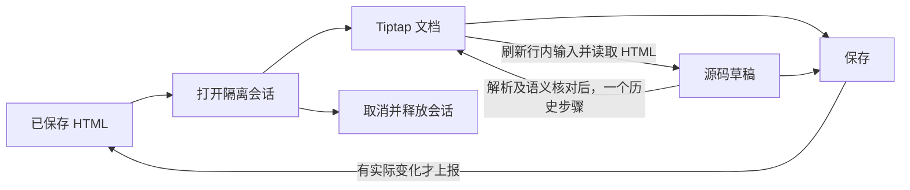

# 富文本编辑器内部架构

界面沿用现有两行工具栏、右侧属性区、行内节点和源码切换。外部字段接口仍是 `definition/value`、`update:value` 与 `activate()`。

## 数据所有权

| 数据 | 所有者 | 写入边界 |
| --- | --- | --- |
| 已保存 HTML | 调用方字段 | 用户保存时，至多上报一次 |
| 可视化内容、历史、选区 | 当前 Tiptap 实例 | 编辑器事务 |
| 源码草稿 | `useRichTextSession` | 源码模式的用户输入 |
| 格式值 | `useRichTextFormatting` | 从文档和选区派生，区分未设置、单值、混合值 |
| 浮层操作目标 | `richTextInteraction` | 捕获选区 bookmark，随事务映射，失效即释放 |
| 颜色预览 | 编辑器插件 | decoration，不写入内容或撤销历史 |
| 字体和图片的运行时解析结果 | 资源环境 | 仅用于显示，不进入文档 |

打开时的原文及对应不可变文档、最近一次源码交接的原文及对应不可变文档，只是读取基线。它们不接受用户编辑，也不与当前文档双向同步。当前文档回到某个基线时，读取对应原文，避免无修改保存重写 HTML。

## 内容生命周期

- 切换模式保留同一个编辑器实例。没有修改的切换不生成历史；源码修改交接以一个独立历史步骤替换文档。
- 保存前刷新正在编辑的 Binding。中文组合输入尚未完成时，暂不交接或保存；取消不提交草稿。
- HTML 只在初始化、交接和保存等边界转换。按键操作不序列化 HTML，也不经父组件回传重建文档。
- 不能保留现有内容语义时继续显示源码和原因，保留原文；不因此拒绝整个文档。源码保存沿用原有安全校验。
- 切换模式、取消和关闭都结束临时格式交互；关闭后创建的新会话不复用旧草稿或异步结果。

## 格式交互

1. 从编辑区进入工具栏、侧栏或浮层时捕获原选区，覆盖鼠标及键盘聚焦。
2. 工具栏和侧栏共享格式投影。只写用户指定的字段，不用混合值的显示回退重写相邻属性。
3. 命令通过统一的交互入口执行。bookmark 恢复原选区类型，避免把图标或表格选区转换成文本选区。
4. 颜色预览只添加显示 decoration；提交才写入正式事务，取消只清除 decoration。
5. 新选区结束旧操作目标；文档修改映射目标，目标消失或选区类型失效时释放。

`PropertyFieldRenderer` 已有字段级预览/取消事件；`PropertyEditor` 只透传为 `preview-property` / `cancel-property` 意图，不维护富文本草稿。既有 `update-property` 仍表示正式提交。

## 模块边界

- `OcRichTextEditor.vue`：组装原有工具栏、编辑区与属性控件。
- `OcDialog`：公开默认、`footer`、`sidebar` 插槽、`sidebar` 开关、`v-model:open` 与可选 `v-model:sidebar-open`；`OcDialogLayout` 是其内部布局，复用 CDE 所用的 `OcResizeTrack`。侧栏位于完整主窗口的外部右侧，主窗口与侧栏共用一个模态焦点范围。富文本通过公开的只读属性投影及格式命令组装侧栏，不再持有任何侧栏布局。弹窗主窗口使用现有 `xl` 尺寸预设。
- `useRichTextEditor`：创建编辑器、编排格式及资源操作，提供读取 HTML、应用源码、刷新行内输入、聚焦和结束交互的内部接口。
- `useRichTextSession`：单次窗口会话、模式及保存/取消。
- `useRichTextFormatting` / `richTextInteraction`：格式读取与命令、选区及临时显示。
- `richTextStyleExtensions` / `richTextEditorHtml`：编辑词汇表、动态样式和稳定字体引用的边界转换。数据属性形式的填充与阴影同样属于字符样式，不要求额外的 `style` 属性。
- `BindingNodeView`：行内输入草稿；复用 `usePropertyCompletion`，取消、失焦和卸载时废弃迟到结果。
- `richTextHtml`：安全渲染投影和诊断。`richTextResourceStyle` 供编辑区、字段预览和卡片渲染共用图片填充解析语义，解析服务由各自的环境提供。

字体继续使用项目既有 `toCssFontFamily/fromCssFontFamily` 稳定编码。保存结果不包含实际作用域字体名、编辑用 CSS 变量、临时图片 URL 或编辑专属属性。图标引用继续使用项目/资源包坐标协议。

## 验证边界

真实组件测试覆盖选区类型、混合格式、颜色预览历史、源码往返、保存取消、资源引用及 Binding 组合输入与异步取消。浏览器入口位于忽略目录 `opencard-app/output/playwright/`，用于截图、键盘选区、格式输入和模式交接验证，不进入产品路由。

浏览器组合事件测试不等同于实际操作系统输入法测试；Tauri 原生窗口中的输入法及资源文件可用性仍需在真实项目中复核。

2026-10-15 最终验证记录：

- 外置侧栏改造前，全套 218 个测试文件、1379 项测试通过；UI 检查及 Vite 生产打包通过。外置侧栏的新增验证另行记录，不沿用此前结论。
- 浏览器实际操作验证了格式输入、颜色预览取消与撤销、源码交接、Binding 提交及所报 HTML 的无损往返。新增侧栏验证了拖宽、双击收起与恢复、从右边缘拉开、键盘操作、Esc 取消拖动及隐藏字段不进入 Tab 顺序；展开后格式命令仍作用于原选区。
- 截图保存在忽略目录 `opencard-app/output/playwright/`，包含原始基线与改造后布局。
- `vue-tsc` 及包含类型检查的标准构建仍被基线已有的 `useAppPages.ts:63` 页面类型错误阻断：`market` 不属于 `test | export`；本次没有新增类型错误。
